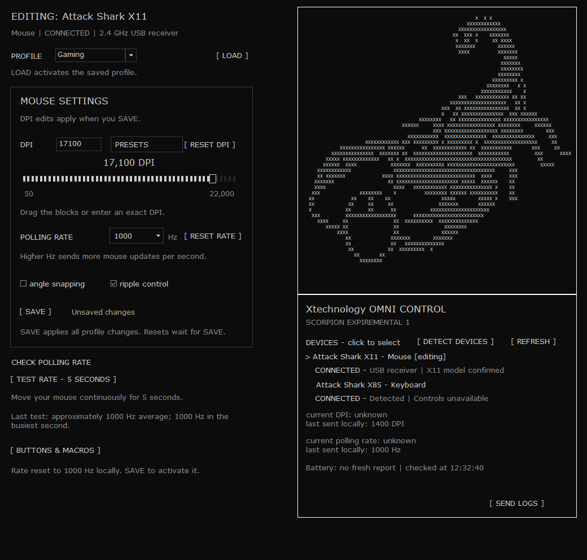

# Xtechnology OMNI CONTROL

**SCORPION EXPIREMENTAL 1** — lightweight mouse configuration for Windows 10/11 x64.

Adjust supported mouse settings through a native Windows interface. Profiles stay local. No account is needed to use the app, and it does not send background analytics or automatically upload logs.

## Download and install

Installer downloads will appear under [Releases](https://github.com/XtechnologyAK/OMNI-CONTROL/releases). The first experimental release is being prepared; its download is not public yet.

1. Download the Windows-x64 ZIP and extract all files.
2. Open the extracted folder and run `INSTALL.exe`.
3. Start OMNI CONTROL from its desktop or Start menu shortcut.

Installation is offline, per Windows user, without administrator privileges. Close OMNI before reinstalling; saved local profiles are preserved. The installer installs the bundled version and does not automatically download updates.

## Mouse support

| Model | Connection | Available controls | Status |
| --- | --- | --- | --- |
| Attack Shark X11 | 2.4 GHz | DPI, Hz, button actions, onboard custom macros, local profiles | Settings changes and profile loading tested on the developer's mouse |
| Razer Basilisk V3 | Wired | DPI / Hz with read-back checks | Experimental; real-device testing needed |
| Razer Viper V3 Pro | Wired / 2.4 GHz | DPI / Hz with read-back checks | Experimental; real-device testing needed |
| Logitech G502 HERO | Wired | DPI / Hz, presets, basic button actions | Experimental; onboard mode required |
| Logitech G Pro Wireless / G Pro X Superlight | Wired only | DPI / Hz, presets, basic button actions | Experimental; onboard mode required |

Detection alone does not establish configuration support. Shared wireless receivers do not confirm the paired mouse model. Other detected mice can attempt the five-second polling-rate measurement. Attack Shark X85 keyboards are detection-only.

SAVE stores and activates edited supported settings. LOAD activates a saved X11 profile; selecting its name previews it.

## Current limitations

- X11 current DPI / Hz cannot be read back. Local drafts and last-sent values are labelled separately. A detected receiver does not prove its wireless mouse is awake. Battery reports are unverified.
- Razer macros / profiles, Logitech custom macro recording and RGB controls are unavailable.
- The SEND LOGS online receiver is not connected in this build.
- There is no automatic updater.

The developer observed approximately 2 MB in Task Manager at idle on their PC. This is private working-set memory, not total memory or a guaranteed maximum. Usage varies with the PC and activity. The screenshot above is a sample interface view, not proof of settings support on every mouse.

## Antivirus status — 11 October 2026

This renamed build is unsigned and has not yet been scanned. It may display a SmartScreen unknown-app warning.

The preceding build received a Kaspersky detection on VirusTotal, while Kaspersky OpenTIP labelled the same EXE hash Clean. Reanalysis was requested; the discrepancy remains unresolved. Neither this nor an experimental label is a safety guarantee. Checksums accompany release downloads.

## Testing and support

See [TEST-CHECKLIST.txt](TEST-CHECKLIST.txt) for device tests. Automated checks passed for the renamed app and installer, including offline installation and profile preservation; they do not replace physical testing on each mouse.

Report the exact mouse model, connection, Windows version, steps to reproduce and error text through [Issues](https://github.com/XtechnologyAK/OMNI-CONTROL/issues). Do not post personal logs publicly.

This repository contains release information and test instructions. Third-party licenses are included in the installer's application folder.

[Support OMNI CONTROL on Ko-fi](https://ko-fi.com/omnicontrol)
